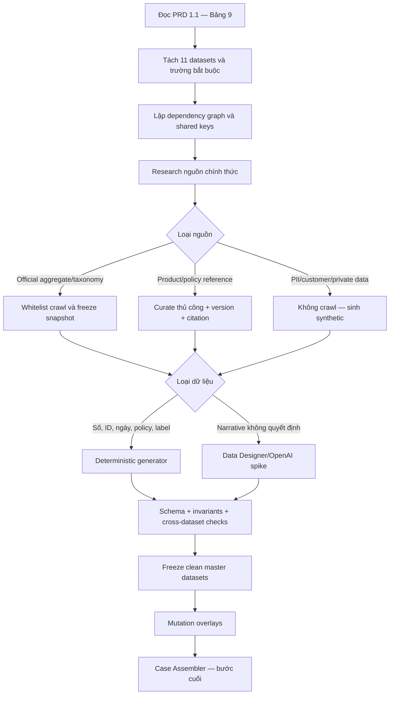

> 🇬🇧 **English version first** · 🇻🇳 Bản tiếng Việt ở bên dưới (xem mục “Tiếng Việt”).

# Synthetic data research flow (English)

A single flowchart (below, with Vietnamese labels) of how the synthetic dataset is produced:

1. Read PRD 1.1 — Table 9, split it into 11 datasets and their mandatory fields.
2. Build the dependency graph and shared keys.
3. Research official sources, then classify each source:
   - **Official aggregate/taxonomy** → whitelist crawl and freeze a snapshot.
   - **Product/policy reference** → curate manually, with version + citation.
   - **PII/customer/private data** → never crawl; generate synthetic data.
4. By data type: numbers, IDs, dates, policies, labels → **deterministic generator**; non-decisive narrative → Data Designer / OpenAI spike.
5. Validate with schema + invariants + cross-dataset checks → freeze clean master datasets → apply mutation overlays → **Case Assembler** (final step).

---

## 🇻🇳 Tiếng Việt

